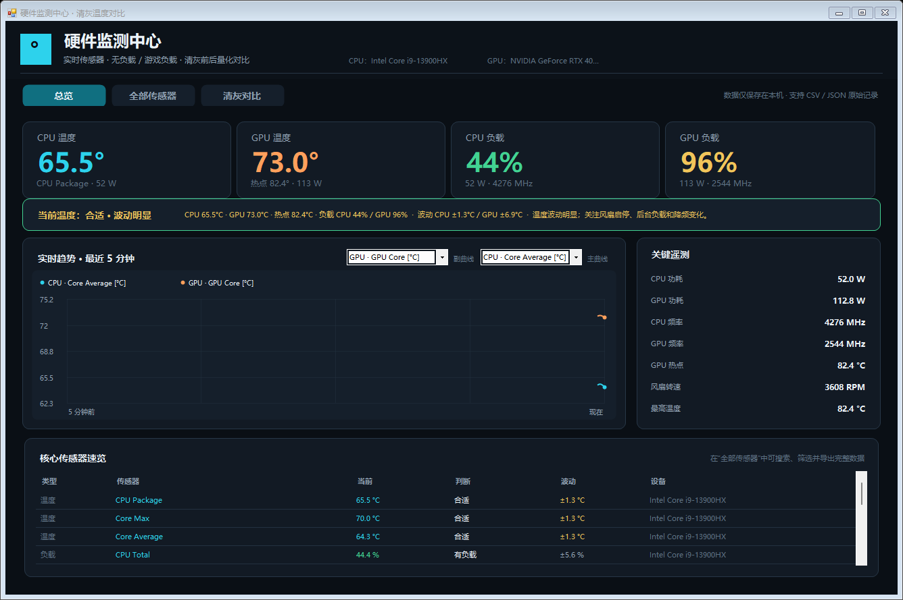
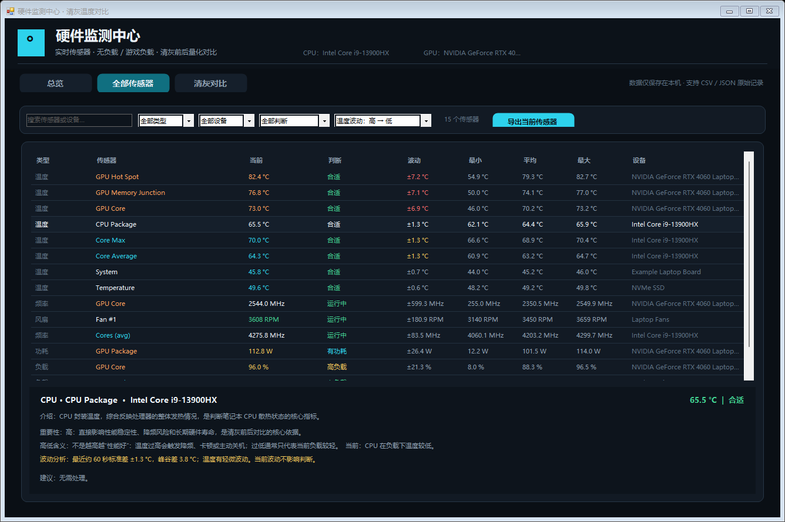
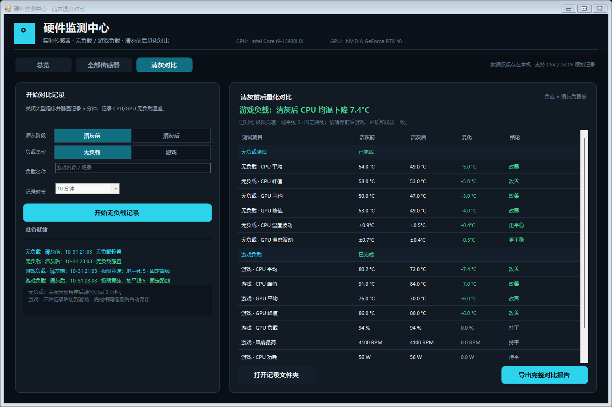

# 硬件监测中心

面向 Windows 笔记本的实时硬件传感器监测与清灰前后量化对比工具。

本项目读取 CPU、GPU、主板、内存、固态硬盘和风扇等可用传感器，提供温度健康判断、近期波动分析、无负载/游戏两类标准化记录，以及清灰前后的逐项对比。

> 界面截图中的硬件与数值为演示数据，并非某台真实电脑的基准结果。



## 主要功能

- **完整实时传感器**
  - 温度、风扇转速、负载、功耗、频率、电压、电流、吞吐量和容量等实际可读项目。
  - 每秒刷新当前值、最小值、平均值和最大值。
- **按判断和类型分类**
  - 可按“合适、偏热、过高、危险、空闲、有负载”等判断动态筛选。
  - 可按 CPU、GPU、主板、内存、存储等设备筛选。
  - 可按传感器类型和名称搜索。
- **多种排序**
  - 传感器名称 A–Z。
  - 当前值高到低、低到高。
  - 温度高到低、低到高。
  - 近期温度波动高到低、低到高。
- **温度健康判断**
  - 总览页直接显示“当前温度：合适 / 偏热 / 过高 / 危险”。
  - 同时结合 CPU/GPU 当前负载，减少把游戏升温误判为异常。
  - 自动纳入 GPU 热点和近期温度波动。
- **传感器教学详情**
  - 点击任意传感器，可查看它测量什么、为什么重要、数值高低意味着什么，以及当前建议。
- **清灰前后对比**
  - 负载类型只有两种：**无负载**和**游戏**。
  - 无负载：固定静置记录 5 分钟。
  - 游戏：可选择记录 5、10、15 或 20 分钟。
  - 自动输出清灰前、清灰后的平均温度、峰值温度、功耗、GPU 负载、风扇转速和温度波动。
- **本地数据**
  - 每秒原始采样 CSV。
  - 含全部传感器统计的 JSON 历史记录。
  - 可导出一键对比报告和当前传感器快照。
  - 不上传云端，不包含遥测。





## 运行要求

- Windows 10 或 Windows 11，64 位。
- .NET Framework 4.8。
- 管理员权限。部分 CPU 和主板传感器必须通过底层驱动读取。
- 首次使用需安装 LibreHardwareMonitor 官方使用的 PawnIO 驱动。

## 快速开始

1. 从 [最新 Release](https://github.com/Monorths/hardware-monitoring-center/releases/latest) 下载 `HardwareMonitorCenter-v2.3-Windows-x64.zip`。
2. 完整解压，不要直接在压缩包内运行。
3. 双击 `HardwareMonitorCenter.exe`，允许 Windows 管理员权限请求。
4. 首次运行按提示安装 PawnIO，完成后回到程序。
5. 打开“全部传感器”确认 CPU、GPU 温度已经出现。

## 清灰前测试

### 1. 无负载温度

1. 关闭游戏、渲染、压缩和下载等大型任务。
2. 保持平时使用的电源模式、摆放位置和大致室温。
3. 进入“清灰对比”，选择“无负载”。
4. 点击“开始无负载记录”并静置 5 分钟。
5. 记录完成后会自动保存并显示清灰前结果。

### 2. 游戏温度

1. 选择“游戏”。
2. 填写游戏名称和固定场景，例如“某游戏 · 训练场往返”。
3. 选择 5、10、15 或 20 分钟。
4. 点击开始后立即切换到游戏。
5. 保持固定画质、分辨率、场景和大致操作。
6. 到时自动保存，也可以手动点击“结束并保存”。

清灰后使用同样的无负载和游戏流程再记录一次。软件会分别显示两类负载的清灰前、清灰后、差值和结论。

完整操作说明见 [docs/USAGE.md](docs/USAGE.md)。

## 当前温度如何判断

程序会选择 CPU、GPU 和 GPU 热点中风险最高的一项，再结合当前负载判断：

| 状态 | 常见参考 |
| --- | --- |
| 合适 | 无负载通常低于 60–65°C；游戏负载 CPU 约低于 80°C、GPU 约低于 86°C |
| 偏热 | 游戏负载 CPU 约 80–89°C、GPU 约 86–94°C，或静置温度明显偏高 |
| 过高 | 游戏负载 CPU 约 90°C 以上、GPU 约 95°C 以上，可能发生降频 |
| 危险 | CPU 接近 100°C、GPU 热点接近 110°C 以上 |

这些范围用于笔记本日常判断。不同型号的厂商功耗策略、温度墙和传感器位置差异很大，应以设备厂商规格为最终依据。

## 温度波动如何计算

- 使用最近约 60 个一秒采样计算标准差。
- 同时计算这段时间的峰谷差。
- 标准差低于 `0.8°C`：平稳。
- `0.8–2.0°C`：轻微波动。
- `2.0–3.5°C`：波动较大。
- 高于 `3.5°C`：波动明显。

程序会结合温度与波动给出不同解释：

- 温度高但波动平稳：更可能是持续散热不足。
- 温度合适但波动明显：更可能与风扇调速、后台负载、功耗限制或降频有关。
- 清灰对比中的波动负值表示清灰后更平稳。

传感器分类、阈值与算法见 [docs/SENSORS.md](docs/SENSORS.md)。

## 为什么有些传感器没有数据

每台电脑能读取的传感器不同。部分风扇转速、电压、显存温度或主板温度可能由厂商隐藏，也可能只对特定驱动开放。程序会显示当前设备实际提供的数据，不会伪造缺失值。

## 构建

### 一键构建

```powershell
powershell -ExecutionPolicy Bypass -File .\build.ps1
```

构建脚本会：

1. 从 LibreHardwareMonitor 官方 GitHub Release 获取依赖并校验 SHA-256。
2. 获取官方内置的 PawnIO 安装器并校验 SHA-256。
3. 使用 .NET Framework C# 编译器构建。
4. 在 `dist/` 生成运行目录和可分发 ZIP。

### Visual Studio / MSBuild

先生成 `vendor/runtime`：

```powershell
powershell -ExecutionPolicy Bypass -File .\scripts\fetch-deps.ps1
```

再打开 `HardwareMonitorCenter.csproj`，或执行：

```powershell
msbuild .\HardwareMonitorCenter.csproj /p:Configuration=Release
```

## 数据与隐私

- 程序不联网上传传感器数据。
- 记录保存在程序目录下的 `Reports` 文件夹。
- 如果程序目录不可写，会回退到 `%LOCALAPPDATA%\CleanTempCompare\Reports`。
- JSON、CSV 中会包含硬件名称、测试时间和传感器统计，发布记录前请自行检查隐私内容。

数据字段说明见 [docs/DATA_FORMAT.md](docs/DATA_FORMAT.md)。

## 项目结构

```text
src/                应用源码、清单和配置
tools/              图标生成与界面自检工具
docs/               使用说明、传感器说明、数据格式和架构文档
scripts/            第三方依赖获取脚本
.github/workflows/  Windows CI 构建
build.ps1           本地一键构建
```

## 安全提示

- 本工具的压力来源由用户启动的游戏产生，本身不包含 CPU 压力测试。
- 温度超过 CPU 105°C、GPU 100°C 或 GPU 热点 115°C 时，记录会自动终止。
- 散热器明显松动、风扇停转或设备已有硬件故障时，请勿进行游戏高负载测试。
- 软件判断只能作为维护参考，不构成硬件维修或保修承诺。

## 贡献

欢迎提交 issue 和 pull request。请先阅读 [CONTRIBUTING.md](CONTRIBUTING.md)。

## 许可证

本项目原创源码和文档使用 [MIT License](LICENSE)。

第三方组件：

- LibreHardwareMonitorLib 0.9.6，MPL-2.0。
- PawnIO Setup，由 LibreHardwareMonitor 官方软件内置使用。

详见 [NOTICE.md](NOTICE.md) 和 [THIRD-PARTY-LICENSE-MPL-2.0.txt](THIRD-PARTY-LICENSE-MPL-2.0.txt)。
